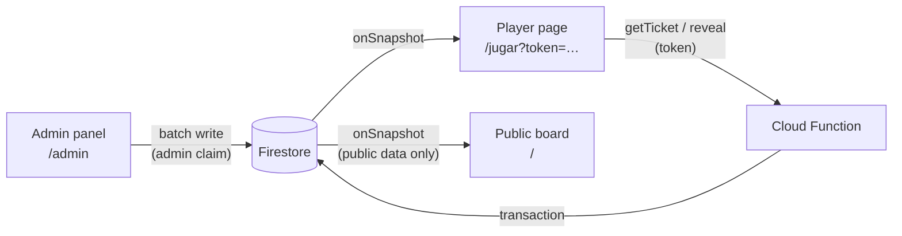

# firebase-raffle — real-time raffle on Firebase

[](https://github.com/nikkibraiam/firebase-raffle/actions/workflows/ci.yml)

A raffle web app with a live 1,000-number board. The organizer sells numbers
and sends each buyer a private link. Buyers open the link and reveal their
numbers one by one with an animation, and everyone watches the board fill up in
real time. Four winning numbers are on the board from day one. Whoever reveals
one of them wins.

Vue 3 + Vite SPA · Cloud Firestore (real time) · Firebase Auth (admin) ·
a callable Cloud Function for reveals · Firebase Hosting. The UI is in Spanish
because the audience is in Colombia; the code and docs are in English.

## How it works



1. **Campaign setup (admin):** four winning numbers are drawn and shown on
   the board. Each one is secretly bound to an *activation point*, the exact
   sale at which it is handed out (one per quarter of the board).
2. **Selling (admin):** the admin records a purchase (buy 4, get 1 free).
   Numbers are assigned at random. If the purchase crosses an activation point,
   that winner is placed at that exact position. Everything (ticket, public
   ranking entry, board cells) is written in one atomic batch. The admin
   copies the link `/jugar?token=<uuid>` and sends it to the buyer.
3. **Revealing (player):** the player page asks the `reveal` function for the
   next number. The function validates the token and records the reveal in a
   transaction. The animation then plays back a result that is already saved.
4. **Public board:** shows sold / revealed / winning cells, a ranking of buyers
   (name + last 3 phone digits) and the prizes already claimed.

## Security model

The ticket token in the link is the player's only credential. The design
keeps it secret and does not trust the client.

| Data | Where | Who can read | Who can write |
|---|---|---|---|
| Board cells: `sold` / `revealed` / `winner`, plus the owner's public id once revealed | `grid/{n}` | everyone | admin |
| Ranking: name, last 3 phone digits, total | `publicParticipants/{publicId}` | everyone | admin |
| Prizes claimed, closing date, price | `config/campaign` | everyone | admin |
| Winning numbers' activation points, assigned winners | `config/winners` | admin | admin |
| Ticket: phone, payment method, **all** numbers, progress | `participants/{token}` | admin | admin |
| Phone book (autocomplete across campaigns) | `users/{phone}` | admin | admin |

- **Players never touch Firestore directly.** `getTicket` returns only the
  numbers already revealed. `reveal` runs in a transaction, so concurrent calls
  can't reveal a number twice or skip one.
- **The token is never published.** Board cells point to a separate random
  `publicId`, and only after the owner reveals. Before that, nobody can tell
  who owns a number, or whether a winning number has been handed out.
- **Signing in is not enough to be admin.** Rules require the custom claim
  `admin: true`. Otherwise anyone could create an account with the client SDK
  and get write access.
- Everything above is covered by tests against the emulator (see *Tests*).

Production hardening not included: App Check on the callables and rate
limiting per IP.

## Run it locally (no Firebase account needed)

Requires Node 20+ and Java 17+ (for the Firestore emulator).

```bash
npm run setup                 # installs app + functions dependencies
cp .env.example .env          # example values for the offline "demo-rifas" project

npm run emulators             # terminal 1: Auth, Firestore, Functions + UI on :4000
npm run seed                  # terminal 2: demo campaign, fictitious buyers, admin user
npm run dev                   # terminal 2: app on http://localhost:5173
```

The seed prints the admin credentials (`admin@demo.test` / `demo-admin-123`,
which exist only in the emulator) and one player link per demo buyer. All
names and phone numbers in the seed are fictitious.

Organizer details shown on the public page (payment accounts, WhatsApp) live
in `src/organizer.js` and are example values.

## Tests

```bash
npm test          # runs everything inside the emulators (firebase emulators:exec)
npm run test:unit # pure raffle logic only, no emulators
```

- `tests/raffle.test.js`: number assignment, activation points, courtesy
  numbers, and a regression test for a winner being handed out twice.
- `tests/firestore.rules.test.js`: what anonymous users, signed-in non-admins
  and admins can read and write (`@firebase/rules-unit-testing`).
- `tests/reveal.functions.test.js`: the callables through the Functions
  emulator, including concurrent reveals of the same ticket.

On slow machines, the Functions emulator may need more time to load the code:
`FUNCTIONS_DISCOVERY_TIMEOUT=60 npm test`.

## Deploy to your own Firebase project

1. Create a project and enable Firestore, Email/Password Auth and the Blaze
   plan (Cloud Functions requires it).
2. Put your web app config in `.env` and set `VITE_USE_EMULATORS=false`.
3. `npx firebase use --add`, then
   `npm run build && npx firebase deploy --only hosting,firestore:rules,functions`.
4. Create the admin user in *Authentication → Users*, then grant the claim:
   `gcloud auth application-default login && node scripts/set-admin.mjs <project-id> <email>`.

## Project layout

```
src/lib/raffle.js        pure raffle logic (shared by admin panel, seed and tests)
src/views/               PublicPage, PlayerPage, AdminPage
functions/index.js       getTicket / reveal callables
firestore.rules          access rules (see Security model)
scripts/seed.mjs         demo data for the emulators
scripts/set-admin.mjs    grant the admin claim in a real project
```

## License

MIT
